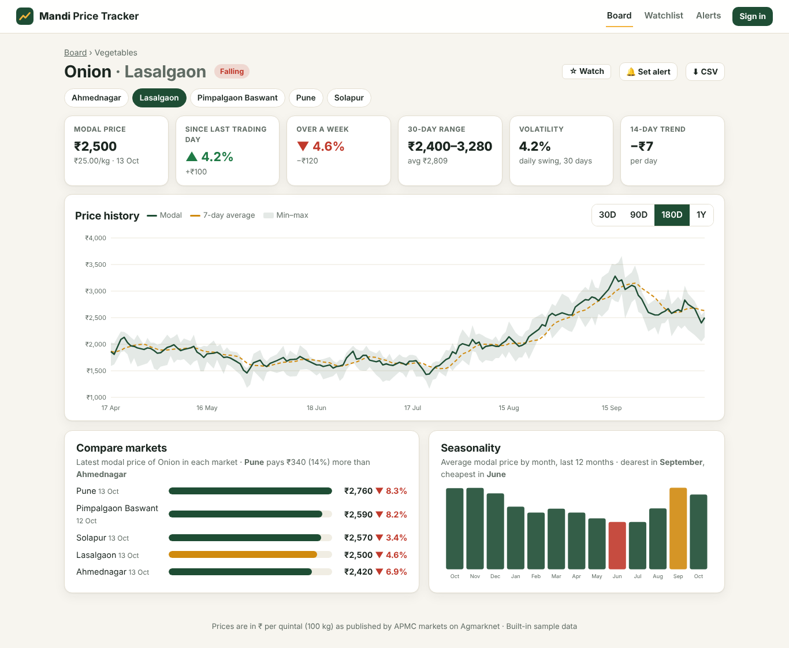
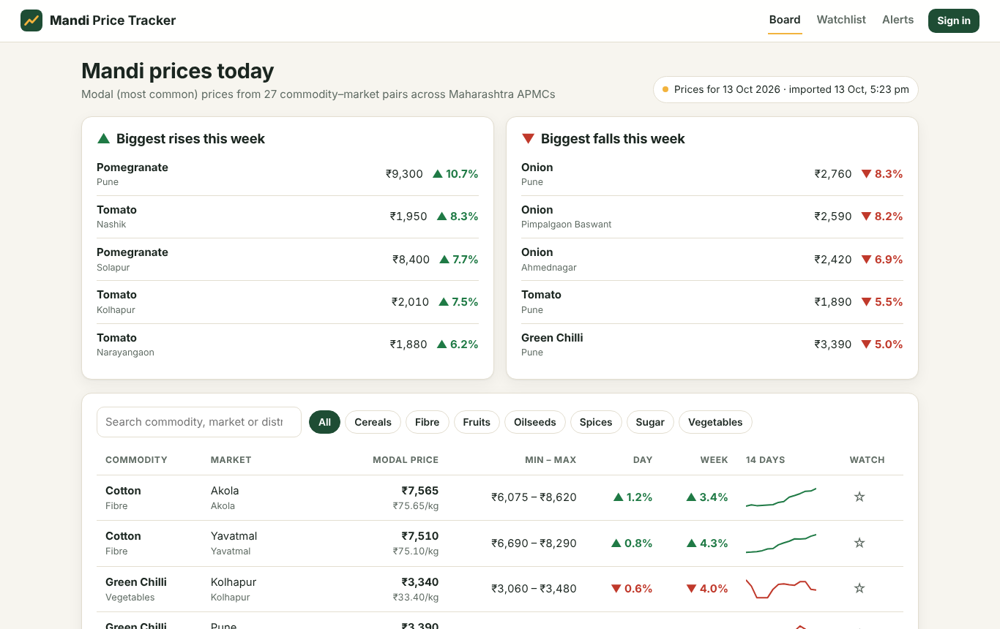
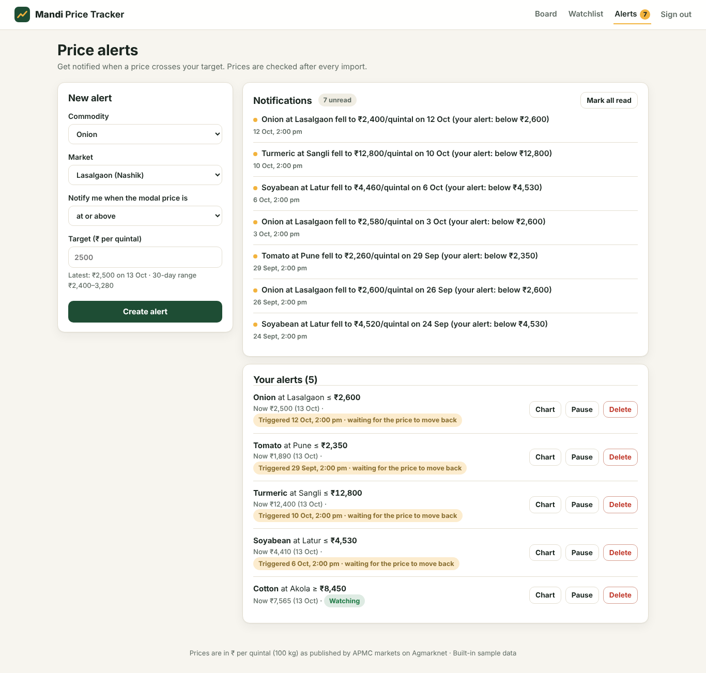
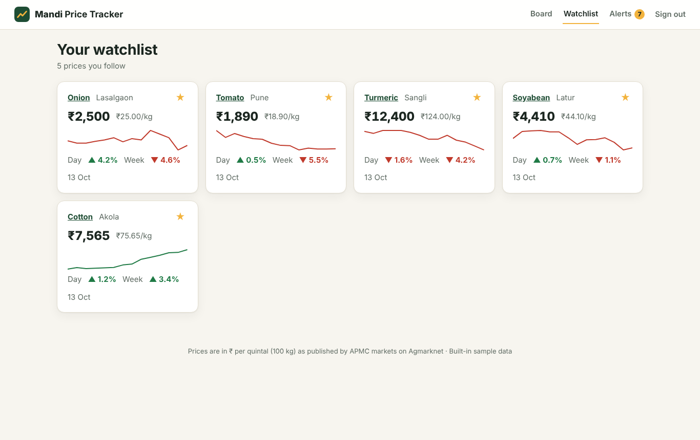
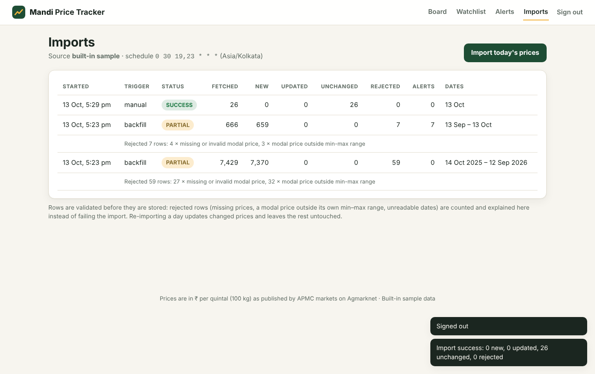
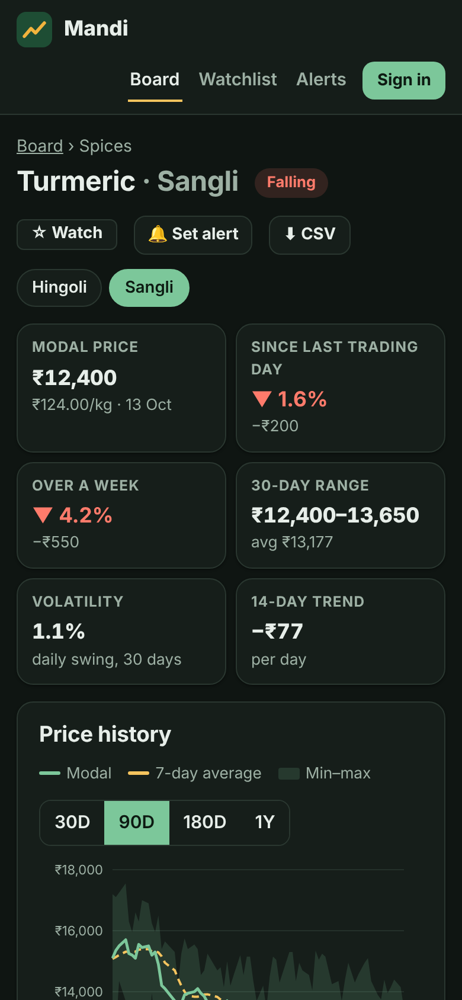
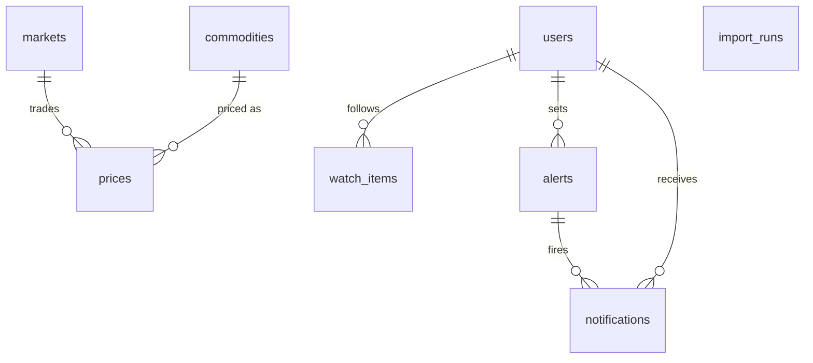

# Mandi Price Tracker

Daily crop prices from Maharashtra's APMC markets (mandis): what onion fetched in Lasalgaon today, whether tomato is rising in Pune this week, which market pays the most for turmeric, and an alert when soyabean falls below your target.

The app imports prices on a schedule from the Government of India open data API (**data.gov.in / Agmarknet**). It cleans and stores them in **MySQL**, then turns them into trends, market comparisons and seasonality charts. Signed-in users get a watchlist and price alerts.

**Stack:** Java 21, Spring Boot 3, Spring Security (JWT), Spring Data JPA, Flyway, MySQL 8 (H2 for development), Spring `@Scheduled` imports, Java `HttpClient`, and a responsive vanilla-JavaScript front end with hand-built SVG charts (no build step).

**Tests:** 67 JUnit tests (unit, Mockito, a local HTTP server standing in for data.gov.in, and MockMvc integration tests on H2 and real MySQL) plus 12 Playwright end-to-end tests. GitHub Actions runs all of them.



| Market board | Price alerts | Watchlist | Import log | Mobile (dark) |
|---|---|---|---|---|
|  |  |  |  |  |

---

## Features

- **Market board:** the latest modal price (the most common trading price) for every commodity in every market. Each row shows the change since the last trading day and since a week ago, the min–max range, a 14-day sparkline, and the price per kg. You can search and filter by category, and the week's biggest rises and falls are listed at the top.
- **Commodity page** with six headline numbers:
  - the modal price
  - the change since the last trading day
  - the weekly change
  - the 30-day range and average
  - volatility
  - the 14-day trend in ₹ per day

  It also has:
  - a price chart (min–max band, modal price and 7-day moving average) for 30 days, 90 days, 180 days or 1 year, with a hover tooltip
  - a **market comparison** showing where the price is highest
  - **seasonality** (monthly averages) showing the dearest and cheapest months
  - a **CSV export**
- **Watchlist:** star any price to follow it.
- **Price alerts:** "tell me when onion at Lasalgaon is at or above ₹2,600". Alerts are checked after every import, and fired alerts appear as in-app notifications with an unread badge.
- **Import log** (admins): every run with its counts of fetched, new, updated, unchanged and rejected rows, the reasons for rejections, how many alerts fired, and an "Import today's prices" button.

## The interesting parts

**Scheduled, idempotent imports.** [`ImportScheduler`](src/main/java/com/mandi/ingest/ImportScheduler.java) runs on a cron schedule (19:30 and 23:30 IST by default). [`ImportService`](src/main/java/com/mandi/ingest/ImportService.java) then works through four steps:

1. **Fetch.** It reads the day's rows from the source.
2. **Validate.** It checks each row.
3. **Upsert.** [`ImportWriter`](src/main/java/com/mandi/ingest/ImportWriter.java) loads the existing rows for the batch's dates in **one query** and matches them in memory on (market, commodity, variety, date):
   - a new row is inserted
   - a changed price is updated
   - an identical row is left alone

   A database unique key guarantees there are no duplicates, so re-importing a day is safe. The integration test runs the import again and checks that **0 rows** are inserted or updated.
4. **Evaluate alerts.** Only the series that actually changed are checked.

Only one import can run at a time; a second request gets a 409 instead of racing the first. Every run is recorded in `import_runs`, failures included.

**Messy government data is validated, not trusted.** [`RecordValidator`](src/main/java/com/mandi/core/RecordValidator.java) handles:
- `dd/MM/yyyy` and ISO dates, parsed strictly (31/02 is an error, not 28 February)
- numbers like `"2,150.00"`
- stray whitespace in market names
- blank varieties
- missing min or max prices

It **rejects** rows with:
- a modal price outside their own min–max range
- min above max
- zero, negative or absurd prices
- future dates

Rejected rows are counted with their reasons (for example "4 × missing or invalid modal price") and do not fail the import. The run is marked PARTIAL.

**Alerts are edge-triggered with hysteresis.** [`AlertRule`](src/main/java/com/mandi/core/AlertRule.java):
- A plain "price ≥ ₹2,500" check would notify every day the price stays high. Instead an alert **fires once** when the price crosses the target, then disarms.
- It **re-arms only after the price moves clearly back** (2% past the threshold). A price hovering around ₹2,500 therefore doesn't spam the user.
- A new alert that the current price already satisfies starts disarmed and waits for a fresh crossing.

**Analytics in plain Java.** [`PriceAnalytics`](src/main/java/com/mandi/core/PriceAnalytics.java) has no database access, so it is easy to unit-test:
- **7-day moving average:** the series is fetched with extra history so the line starts on the first day shown.
- **Day and week changes:** markets close on Sundays and holidays, so the "previous day" is the previous *trading* day.
- **30-day range and volatility:** volatility is the standard deviation of the daily % changes.
- **14-day trend:** a least-squares slope in ₹ per day, measured over calendar days so closures are respected.

**Prices as the database sees them.** All prices are whole rupees per quintal, as Agmarknet publishes them, with a `CHECK (min <= modal <= max)` constraint. Some markets report several varieties of a commodity on the same day. In that case the series query (`GROUP BY` date) uses the widest min–max range and the average modal price.

**Two price sources behind one interface** ([`PriceSource`](src/main/java/com/mandi/ingest/PriceSource.java)):

| `PRICE_SOURCE` | What it does |
|---|---|
| `datagov` | [`DataGovInSource`](src/main/java/com/mandi/ingest/DataGovInSource.java) calls the data.gov.in resource *Current Daily Price of Various Commodities from Various Markets (Mandi)*. It pages through the results, filters by state, and **retries** timeouts, 429 and 5xx responses with exponential backoff. It does not retry a bad API key (403). Needs a free key from data.gov.in. |
| `sample` (default) | [`SampleSource`](src/main/java/com/mandi/ingest/SampleSource.java) is a deterministic generator covering 27 commodity–market series in 15 real Maharashtra APMCs. It has realistic price levels, seasonal peaks (onion after the monsoon, tomato during it), shocks shared by all markets of a crop, Sunday closures, missing days, and a few malformed rows to exercise the validator. The same date always produces the same rows, so it behaves like a real file. |

**Demo data comes from the real pipeline.** On first start with `DEMO_DATA=true`, [`StartupData`](src/main/java/com/mandi/config/StartupData.java) works in three steps:
1. It imports a year of history through the actual import service.
2. It creates a demo user whose watchlist and alerts are dated a month back.
3. It imports the last 30 days **one day at a time with alerts on**.

The notifications the demo user sees were therefore produced by the real alert code.

## Architecture

```
src/main/java/com/mandi
├── core/        RecordValidator, PriceAnalytics, AlertRule, AlertDirection, Money (₹1,25,000), Categories
├── ingest/      PriceSource, DataGovInSource, SampleSource, ImportService, ImportWriter, ImportScheduler
├── domain/      Market, Commodity, Price, ImportRun, WatchItem, Alert, Notification, User
├── repository/  Spring Data repositories with JPQL projections (DailyRow, BoardRow, SeriesRef)
├── service/     PriceQueryService (board, series, compare, monthly, CSV), WatchlistService, AlertService, AuthService
├── security/    JwtService, JwtAuthFilter, SecurityConfig (public prices, signed-in features, admin imports)
├── web/         PriceController, AccountController, AdminController, AuthController, DTO records, error handler
└── config/      StartupData, Clock (IST), OpenAPI
src/main/resources/db/migration   V1 schema (unique keys, CHECK constraints, indexes)
src/main/resources/static         index.html · css/app.css · js/app.js, charts.js, format.js, api.js
e2e/tests                         Playwright: board, commodity page, CSV, account, alerts, admin, mobile
```



## REST API

| Method | Path | Access | Purpose |
|---|---|---|---|
| GET | `/api/prices/board` | public | Latest price of every series, changes, sparklines, movers |
| GET | `/api/prices/catalog` | public | Commodities and the markets that trade them |
| GET | `/api/prices/series?commodityId=&marketId=&days=` | public | History with 7-day average, plus statistics |
| GET | `/api/prices/compare?commodityId=` | public | Latest price in every market, highest vs lowest |
| GET | `/api/prices/monthly?commodityId=&marketId=` | public | Monthly averages for the last year |
| GET | `/api/prices/export.csv?commodityId=&marketId=&days=` | public | CSV download (safe against spreadsheet formula injection) |
| POST | `/api/auth/register`, `/api/auth/login` | public | Get a JWT |
| GET / POST / DELETE | `/api/watchlist[/{id}]` | user | Watchlist |
| GET / POST / PATCH / DELETE | `/api/alerts[/{id}]` | user | Create, pause or resume, and delete alerts |
| GET / POST | `/api/notifications`, `/api/notifications/read` | user | Inbox, mark all read |
| GET / POST | `/api/admin/imports` | admin | Import log, run an import now |

Swagger UI: `/swagger-ui.html`.

## Running it

```bash
mvn spring-boot:run          # http://localhost:8080 (H2, a year of sample prices)
```

| Account | Email | Password |
|---|---|---|
| Demo user (watchlist, alerts, notifications) | demo@mandi.in | demo1234 |
| Admin (import log) | admin@mandi.local | Admin@12345 |

To use live Agmarknet prices, get a free API key at [data.gov.in](https://data.gov.in), then:

```bash
cp .env.example .env         # set PRICE_SOURCE=datagov, DATA_GOV_API_KEY, JWT_SECRET, ADMIN_PASSWORD
docker compose up --build    # app + MySQL 8
```

Keep the API key in `.env` (git-ignored) or your host's environment settings, never in the repository.

| Setting | Meaning |
|---|---|
| `PRICE_SOURCE` | `sample` (default) or `datagov` |
| `DATA_GOV_API_KEY`, `DATA_GOV_STATE` | data.gov.in key, and the state to import (default Maharashtra) |
| `IMPORT_CRON`, `IMPORT_ENABLED` | Import schedule in IST (default `0 30 19,23 * * *`), on or off |
| `JWT_SECRET` | HS256 signing key, at least 32 characters. **Always set this in production.** |
| `ADMIN_EMAIL`, `ADMIN_PASSWORD` | The admin account, created on first start if missing |
| `DEMO_DATA` | `true` loads a year of sample history and the demo user into an empty database |
| `SPRING_PROFILES_ACTIVE=mysql` + `DB_URL`, `DB_USER`, `DB_PASSWORD` | Use MySQL instead of H2 |

## Tests

```bash
mvn verify                                    # 67 JUnit tests + JaCoCo coverage report
cd e2e && npm install && npx playwright install chromium
BASE_URL=http://localhost:8080 npx playwright test    # 12 browser tests (app must be running)
```

| Layer | Tests | What is covered |
|---|---|---|
| Core | 21 | Validator (formats, strict dates, every rejection rule); analytics (moving average, trading-day changes, week reference, 30-day window, slope over calendar days, volatility by hand); alert decision table, hysteresis, alerts created past their threshold; Indian rupee grouping |
| Ingest | 18 | Import of new rows; re-import updates only what changed; rejected rows with reasons; failed and empty runs; one import at a time; monthly batches for history; fired alerts counted; sample data is deterministic, closed on Sundays, valid and seasonal; data.gov.in paging, retry on 503, no retry on 403 (against a local HTTP server) |
| Services | 18 | Series windows and warm-up; board movers and stale series; market comparison; monthly averages; catalogue; CSV escaping; alert crossing, pause and resume, ownership, limits; watchlist; auth; demo alert thresholds |
| Security | 4 | JWT round trip, tampering, wrong key, expiry |
| API integration (H2 and MySQL) | 6 | A year of history loaded at startup; public endpoints and CSV; clear 400/404 errors; 401 and 403 rules; the demo user's alerts fired during the last month of imports; watchlist and alert lifecycle; re-importing today changes nothing |
| End to end (Playwright) | 12 | Board, search and category filters; commodity page, range and market switching; chart tooltip; CSV download; sign-up from the watch star; login error; notifications and mark-read; create, validate, pause and delete an alert; admin import log and re-import; admin page refused to users; phone layout |

CI (`.github/workflows/ci.yml`) has four jobs:
- unit and integration tests on H2
- integration tests on MySQL 8
- Playwright against the packaged jar
- a Docker image build
